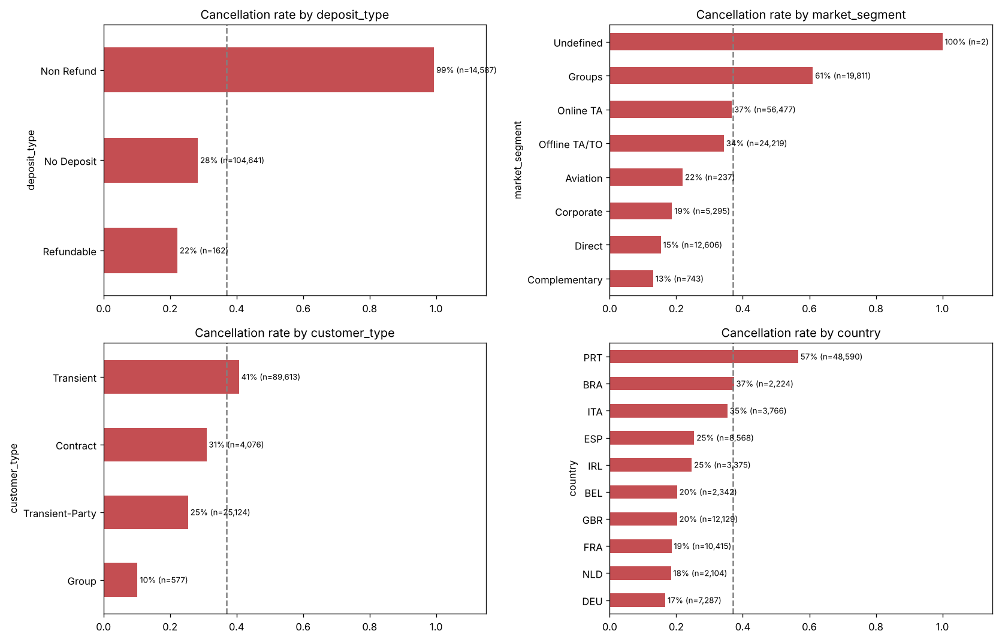
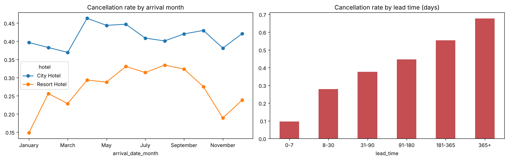
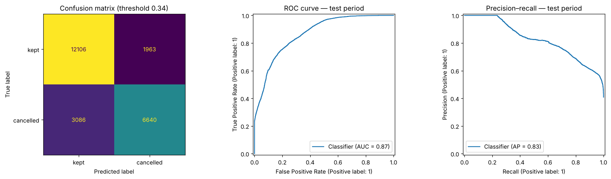

# Will This Guest Actually Show Up? Predicting Hotel Cancellations with CRISP-DM

*How a 25-year-old process model, and three rounds of tough critique, turned a "great classifier" into an honest overbooking forecast.*

Over two years, **37 % of all bookings** at two Portuguese hotels were cancelled; 42 % at the city hotel. Hotels defend themselves by overbooking: selling more rooms than they have, using a rule of thumb like "about 40 % of tonight's bookings won't show". When the rule is too generous, a guest gets "walked" to another hotel. When it's too cautious, rooms stay empty.

Could the bookings themselves tell us how many cancellations to expect, night by night?

I built that model following **CRISP-DM**, the Cross-Industry Standard Process for Data Mining. Its six phases are well known. Less well known is that each phase has specific *tasks*, each with required *outputs*. My first draft reported a classifier with ROC-AUC 0.87 worth "€19,700 per 1,000 bookings". The final version reports something more modest and more useful, and the path between the two is the real story.

## Phase 1 — Business understanding: price the actual decision

The data is public (António, de Almeida & Nunes, *Data in Brief*, 2019): **119,390 bookings** for a resort hotel and a city hotel, July 2015 – August 2017.

CRISP-DM asks for **business success criteria** and a **cost/benefit assessment** before touching the data. Two lessons came from getting this wrong first:

- **Price the outcomes consistently.** A room you overbook is only re-sold, and a guest is only walked, if the hotel actually fills up that night. I first applied that 50 % chance to the walk cost but not to the re-sale. Done consistently, a correct call is worth €50 and a wrong one costs €100: a 2 : 1 ratio, not 1 : 1.
- **Compare with what the hotel does today.** My first benchmark was "flag every booking", which loses money by construction. The real incumbent is the rule of thumb: the historical cancellation rate × the bookings on the books.

The goals were also stated as **data mining criteria** for a per-booking classifier: ROC-AUC ≥ 0.85, precision ≥ 0.75 and recall ≥ 0.50.

## Phase 2 — Data understanding: the field that knew the future

The data came as two files with inconsistent formats ("NULL" as text, padded strings, mismatched types). Routine to fix. Three findings were not:

**Non-refundable deposits cancel 99.4 % of the time.** That's the opposite of what a non-refundable deposit should do. The 14,587 bookings are 97 % group or tour-operator bookings, and **98 % of them are exact duplicate rows**. They look like block allocations released by tour operators, not guests losing their money.

**Some columns are recorded after the fact.** `reservation_status` literally says "Canceled". None of the 7,416 bookings with a parking space were cancelled, so parking is recorded on arrival. Both were excluded.

**Nationality was the biggest trap.** `country` was the model's single most important input: 62 % of cancelled bookings are Portuguese, against 28 % of arrived ones. A reviewer asked whether nationality might be filled in by default and only corrected at check-in. The data can test that. Within each market segment, bookings that **never reached the front desk**, both cancellations *and* no-shows, are Portuguese far more often than bookings that checked out. Among group bookings it is 97 % and 97 % against 29 %. A real nationality effect wouldn't make no-shows look like cancellations and unlike arrivals in the same segment. A default value would. So `country` was **excluded**, like parking. On a validation block, adding it back is worth 0.034 AUC: that's how much the leak had been flattering the model.

## Phase 3 — Data preparation: score code and a time-based split

About 27 % of rows are exact duplicates. With no booking ID they can't be proven to be errors, and profiling showed they're mostly multi-room group bookings, so I kept them. That decision came back in Phase 4.

The feature construction is written as **score code**: a small module the model pipeline calls first, so the app accepts the 24 raw fields a booking system exports.

The data was split **by time**. Everything arriving before 23 April 2017 is for training, and the latest 20 % of arrivals (23,795 bookings) form the test period. A deployed model always predicts bookings that arrive *after* the data it learned from.

## Phase 4 — Modeling: the validation trap

My first version used shuffled 5-fold cross-validation: ROC-AUC **0.956**. On the later test period: **0.868**. Shuffled folds mix future bookings into training, and identical duplicate rows land on both sides of a fold, so the model is rewarded for recognising bookings it has already seen. Switching to **time-series cross-validation**, with fold edges on date boundaries, made validation predict reality.

Three baselines kept the comparison honest:
- a majority-class floor;
- lead time alone;
- the simplest business rule, "flag every Non Refund booking" (precision 0.99, recall 0.33).

Logistic regression, a random forest and gradient boosting each got the same tuning budget. Without nationality, the **random forest** came out best (cross-validated AUC 0.844), ahead on 4–5 of 5 folds.

## Phase 5 — Evaluation: the classifier fails, the forecast succeeds

As a **per-booking classifier**, the honest model misses two of its three targets:
- test ROC-AUC **0.827** (target 0.85);
- recall **0.47** (target 0.50) at the cost-optimal threshold;
- precision **0.83** (target 0.75), the only one met.

Outside the Non Refund blocks it's weaker still (precision 0.71). Telling individual guests apart is hard once the leak is gone.

But the hotel doesn't decide per booking. It decides **how many extra rooms to sell each night**. Missed cancellations and false alarms on the same night cancel out. So I added up the calibrated probabilities of each night's bookings into an *expected number of cancellations*, and simulated every policy over the 262 hotel-nights of the test period:

- **The current rule of thumb:** €13,429 per 1,000 bookings, off by 9.4 rooms per night on average.
- **Counting the model's flagged bookings:** €11,538. Worse than today's rule.
- **The model's expected cancellations:** **€16,804**, off by **4.6 rooms per night**.

That is **€3,400 more per 1,000 bookings than the hotel's current rule** (95 % CI €2,400–€4,300). The confidence interval is entirely above zero.

CRISP-DM's answer is a **decision**, not more tuning. The model is approved for the nightly overbooking forecast, as a randomised pilot. Individual flags are not approved for decisions; they are a watch list.

## Phase 6 — Deployment and monitoring

The Streamlit app takes the day's booking file in the hotel's own format. It returns, per hotel and arrival date, the recommended number of extra rooms to sell, and it warns about category values it has never seen. Guests are never contacted on the basis of the score, and nationality isn't an input. [Try the app](https://cmpe-255-data-mining-process-hotel-cancellations.streamlit.app/).

The pilot is randomised by arrival date: on half of the dates the model sets the overbooking level, on the other half the current rule does. Monitoring uses the Population Stability Index, compares each month with the same month last year, and has responses that don't need outcomes (which only arrive after the stay).

## What CRISP-DM, and its critics, bought me

- **Pricing the real decision** turned a failing classifier into a forecast that beats the incumbent, and showed that the per-booking flags were the wrong tool.
- **"Is this known at booking time?"**, asked of every column and then *tested*, removed the most predictive field, because it was leaking the answer.
- **Honest validation** moved the reported AUC from 0.956 (shuffled), to 0.868 (time-ordered), to 0.827 (without the leak). Each step down was a step closer to what the hotel would actually get.

Three rounds of independent expert critique did most of the catching: corrupted figures, a one-sided cost model, a missing incumbent benchmark, and the untested nationality leak. The phases sound bureaucratic. In practice, each required output is a question you'd otherwise skip.

*Code, notebook, figures, report and app: [github.com/MeronDT/CMPE-255-Data-Mining-process](https://github.com/MeronDT/CMPE-255-Data-Mining-process).*

*AI disclosure: built with help from Claude (Anthropic) for code, drafting and expert critique; all results were produced by running the code.*
