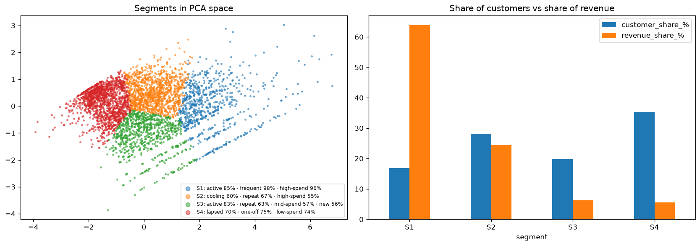
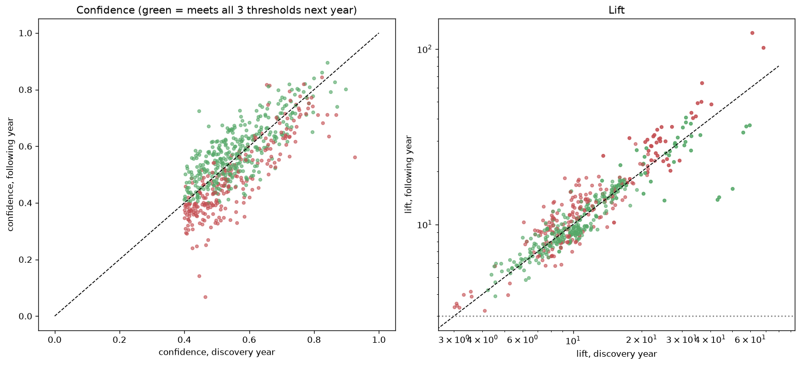

# From a Million Receipts to Knowledge: A KDD Walkthrough on Online Retail Data

*Customer segments and "bought together" rules, discovered in one year, tested on the next, and reviewed three times by independent critics.*

Most data mining tutorials end when the algorithm runs. The **Knowledge Discovery in Databases (KDD)** process, as defined by Fayyad, Piatetsky-Shapiro and Smyth in 1996, insists on more: a pattern only counts as *knowledge* if it is **valid, novel, potentially useful and ultimately understandable**. In this project I took that definition literally. It changed the results, and it made me retract two of my own headline claims.

## The data and the goals

The UCI *Online Retail II* dataset holds the transaction lines of a UK online giftware retailer from December 2009 to December 2011: about 1 million lines, 5,900 customers (many of them wholesalers), 4,700 products, and a sharp Christmas peak.

KDD starts with the domain and the end users. Here there are two:

- **Marketing** wants to know *what kinds of customers we have*, so goal 1 is customer segmentation.
- **Merchandising** wants to sell more per order, so goal 2 is product associations.

Before mining anything, I wrote down how each of Fayyad's four criteria would be *tested*. The key decision: **valid means still true the following year.** Patterns are mined on December 2009 – November 2010 and checked on December 2010 – November 2011, two equal 12-month windows.

## Selection and preprocessing: where the real work was

The data comes as an Excel file with **two sheets**, one per year. Pandas reads only the first by default, which quietly loses half the data. Reading both has its own trap, which a reviewer caught in round 3: the sheets **overlap**. The first runs to 9 December 2010 and the second starts on 1 December, so 22,523 lines were in the data twice. They are now dropped when the file is loaded.

Cleaning then removed:

- 19,165 **cancellation** lines (invoice numbers starting with "C");
- 5,825 purchases that were **cancelled in full**, each matched to *one* earlier purchase in the same year. My first version matched across years, ignored time order and removed 13,653 lines, quietly letting next year's data change this year's;
- 4,661 lines that aren't products: postage, bank charges, Amazon fees, manual adjustments;
- 5,937 lines with zero or negative quantity or price;
- 11,622 exact **duplicate** lines (0.3 % of revenue).

That left 997,638 clean lines. 23 % of lines have no customer ID: useless for segmentation, but perfectly good *baskets*, so they were kept for the association rules. A check later showed they add rules without creating different ones.

## Transformation: two views of the same data

- **A customer table.** For each customer: **R**ecency, **F**requency, **M**onetary value, plus tenure and return rate. RFM spans several orders of magnitude (1 to 174 orders, £2 to £319k), so it was log-transformed and standardised before clustering.
- **A basket matrix.** One row per invoice, one column per product. Products in fewer than 1 % of baskets can never be part of a frequent itemset (the Apriori property), so removing them shrank 4,047 products to 714 without losing a single possible rule at that support.

## Data mining

**Segments:** K-means on the log-RFM table. Silhouette favoured k = 2, which splits customers into "active" and "not", too coarse to act on. Within 3–6, k = 4 had both the best silhouette (0.34) and the best stability: refit on bootstrap resamples, it agreed with itself on the held-out customers at an adjusted Rand index of 0.92. A silhouette of 0.34 is honest about the shape of the data. These are a *useful partition* of a continuum, not natural clusters.

**Rules:** FP-Growth with support ≥ 1 %, confidence ≥ 40 % and lift ≥ 3 found **598 rules from 325 associations** (most pairs appear as A → B and B → A).

## Interpretation and evaluation: the part most projects skip

### The segments

- **Champions** (17 % of customers, **64 %** of revenue): ordered 8 days ago, 9 orders, £3,536.
- **Loyal but cooling** (28 %, 24 %): 4 orders, £1,310, last order 57 days ago.
- **New customers** (20 %, 6 %): 2 orders, £506, about 2 months' tenure.
- **Lapsed one-off buyers** (35 %, 6 %): 1 order, £261, 165 days ago.

**Are they valid?** Built only from 2009-10 data, the segments line up with 2010-11 behaviour exactly in order: **96 %** of Champions bought again, against 74 %, 65 % and **40 %** for the other three.

**But do they beat the standard tool?** No. A plain **RFM score**, the sum of a customer's recency, frequency and spend percentiles cut into quartiles, ranks next-year activity better: AUC 0.765 vs 0.739 for my clusters (gap CI +0.018 to +0.034). I had set "at least as good as an RFM score" as the pass mark, and the clusters fail it. They still earn their place as **labels with distinct actions**: "protect", "re-engage", "develop", "cheap win-back". But the app now shows each customer's RFM score beside the segment, and exports each segment's list ranked by it.

### The rules

**Valid?** My first claim was that "86 % of rules meet the full thresholds again next year". A reviewer pointed out I had re-checked confidence and lift but forgotten **support**. With all three thresholds the answer is **59 %**. That number needs a baseline: rules that *just missed* the thresholds in year one reach them in year two only **12 %** of the time. So passing the thresholds really does pick stable patterns.

**Novel?** Here KDD's criterion bites. Most strong rules are obvious: *pink Regency teacup → green Regency teacup*, children's garden trowel → children's garden fork. They're true, but a merchandiser already knows them. I classified rules as "variant" (same product, other colour) or "cross-product", then hand-checked 40 of them. The classifier was right 95 % of the time for variants and 70 % for cross-product, which suggests **about 57 of the 325 associations are genuine cross-sells**. For example:

- **Matching-design sets across product types:** red spotty paper napkins + cups → red spotty paper plates (84 % confidence, 36× lift, still 90 % confidence the next year);
- Regency teacup and saucer → the matching three-tier cake stand;
- painted metal pears → bird ornament.

The sobering part: only **about a quarter** of cross-product associations hold up the next year, against 62 % of the variants. Customers do shop by *collection*, but the stable cross-sells are a short list, and only the validated ones should be promoted.

**Useful?** At 1 % support, a validated rule fires (all of its "if" products in the basket, its "then" product missing) in 59 % of next year's baskets. But it covers only 109 of 4,047 products. Dropping support to 0.5 % triples the coverage and makes the rules less stable (47 % hold). That trade-off belongs to the business, not the algorithm.

## The critic loop: three rounds

Each stage was reviewed three times with an expert-persona prompt. Rounds 2 and 3 were run by fresh, independent Claude sessions that saw only the finished notebook.

1. **Round 1** found misleading segment labels, a too-lenient validity test and a naive novelty test.
2. **Round 2** found that cleaning leaked across the year split, that the "full threshold" test skipped support, that the segments had no baseline, and, worst, that **the app showed the wrong segments**. It had refit the model on two years of data and mapped the old names onto the new clusters without checking: a "cooling" segment with a 178-day median recency.
3. **Round 3** found the sheet overlap, a coverage number that counted rules that didn't actually fire, and a novelty claim built on the least stable rules.

Every one of these was fixed and the notebook re-run. The final version reports one criterion as failed (segments vs RFM score) and one as only partly met (novelty).

## Acting on the knowledge

KDD's last step is to act. The app ships **the validated model**: the same 12-month segmenter, applied to each customer's most recent 12 months. A check confirms that every segment still matches its name. Staff can:
- enter a whole basket and get the validated recommendations (rules fire only when all their "if" products are present);
- look up a customer's segment, action and RFM score;
- export a segment's customer list for a campaign. `<app link>`

Segments and rules should be re-mined quarterly on a rolling 12-month window, and each version validated on the following year, just as in this notebook.

## What KDD added

Compared with CRISP-DM's business focus and SEMMA's modeling focus, KDD's distinctive contribution is its definition of **knowledge**. Testing each criterion separately is what exposed that my segments don't beat an RFM score, that most "novel" rules are unstable, and that the honest validity figure is 59 %, not 86 %. That made the final list of claims shorter, and every claim on it was tested.

*Code, notebook, figures and app: [github.com/MeronDT/CMPE-255-Data-Mining-process](https://github.com/MeronDT/CMPE-255-Data-Mining-process). Video walkthrough: `<YouTube link>`.*

*AI disclosure: built with help from Claude (Anthropic) for code, drafting and expert critique; all results were produced by running the code.*
