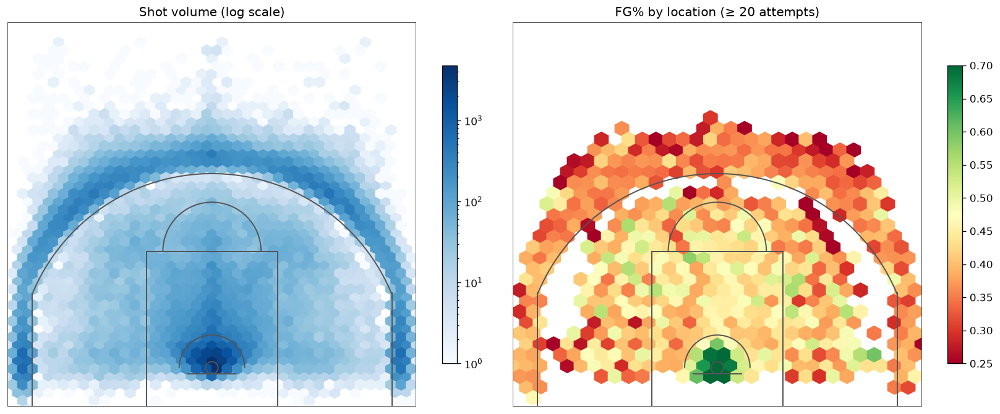
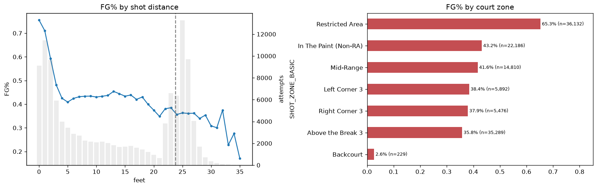
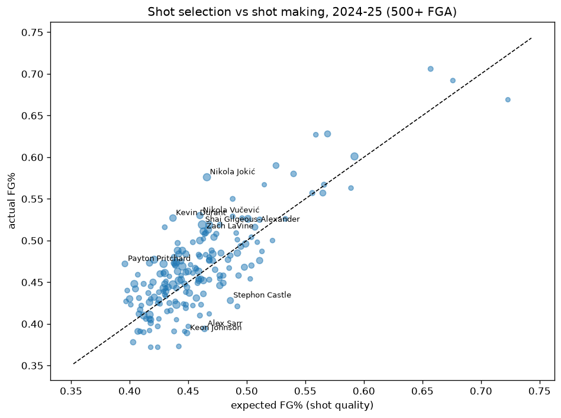

# What Is a Shot Actually Worth? Building an NBA Expected-FG% Model with SEMMA

*Five seasons, a million shots, and SAS's five-step data mining method, applied in Python, with three rounds of expert critique.*

Field-goal percentage is one of basketball's oldest stats, and one of its most misleading. A center who only dunks shoots 65 %; a guard who lives beyond the arc shoots 44 %. Who is the better shooter? Raw FG% can't say, because it mixes two different things: **which shots a player takes** and **how well he makes them**.

Expected field-goal percentage (xFG%) separates them. It asks: *given where and how a shot was taken, how often does the average NBA player make it?* Compare a player's real FG% with the xFG% of the same shots, and what's left is shot making.

I built an xFG% model following **SEMMA** — Sample, Explore, Modify, Model, Assess — the data mining process SAS Institute designed around its Enterprise Miner software. Here's how each step shaped the project, and what three rounds of independent expert review changed.

## The data

Every regular-season field-goal attempt from stats.nba.com, compiled in the open [shufinskiy/nba_data](https://github.com/shufinskiy/nba_data) repository: court coordinates, shot type ("Driving Layup Shot", "Step Back Jump shot"…), period and clock, and whether it went in. Five seasons (2019-20 to 2023-24) form the modeling population: **1,031,740 shots**. The 2024-25 season (**219,527 shots**) was kept out of all model fitting until the very end.

Unlike CRISP-DM, SEMMA has no "business understanding" phase; it assumes you already know the question. So the success criteria were set up front: beat simple zone-average baselines, be well calibrated, and hold up on a season the model has never seen.

## S — Sample: you don't need a million shots

SEMMA's first instinct is to *sample*: extract a portion big enough to contain the signal but small enough to work with quickly.

I drew 200,000 shots, stratified by season and outcome. My first proof of representativeness was circular: FG% "matched the population" because I had stratified on it. The honest test compares the sample with the **832,000 shots I didn't draw**, on variables I didn't stratify on. Shot distance, location, three-point share, the mix of shot types and court zones all matched (every p-value above 0.37).

Was 200k enough? A learning curve, extended to 480,000 shots, showed validation error falling fast up to ~25,000 training shots and then barely moving: the last 360,000 shots bought 0.0013 log loss. Enough to *compare* model families. The model I deployed is refit on more data anyway.

The sample was split 60/20/20 into training, validation and test sets **by game**, so shots from the same game never sit in two partitions.

## E — Explore: where shots go in

The shot charts tell the story every coach knows, now quantified:

- **The rim is a cliff.** 76 % at 0 ft, 59 % at 2 ft, 41 % at 5 ft.
- **Mid-range is flat.** About 43 % from 10 to 15 ft, the reason analytics killed the long two.
- **Corner threes are a little better**, but mostly because they're shorter. At the *same* 24 ft, corners go in 37.0 % vs 35.2 % above the break.
- **How matters as much as where.** Dunks 89 %, layups 56 %, pull-ups 40 %, plain jump shots 37 %.
- **Heaves are their own thing.** Shots from 30+ ft with ≤ 3 seconds left go in 8 % of the time, against 33 % for the same distance with time on the clock.

Exploration also caught a trap: a column called `EVENT_TYPE` ("Made Shot"/"Missed Shot") was the answer itself in disguise. And the shooter's identity, which looked informative, carried almost nothing once I corrected the mutual information for the 800 different player names (0.022 → 0.008). It is excluded by design anyway: the model measures shot *quality*, and who took the shot is analysed afterwards.

## M — Modify: one geometry for every shot

The raw data describes distance five overlapping ways. Modify replaced them with one consistent set of features:
- exact distance, plus finer distance bins right at the rim;
- a corner-three flag and a 3-point flag computed from court geometry (it agrees with the official one on 99.95 % of shots);
- seconds left and a heave flag;
- a **shot family** (dunk, layup, floater, pull-up …), so a rare label like "Running Alley Oop Dunk Shot" is still treated as a dunk.

All of it lives in a small module, `shot_features.py`, that the deployed app imports too: the Python equivalent of the *score code* Enterprise Miner exports.

## M — Model: five contenders and three baselines

Following Enterprise Miner's playbook, five model families competed, each tuned on the validation partition. **Gradient boosting won** with a validation log loss of **0.6338**, tied with an ensemble. A bootstrap over games showed the gap between them is noise, so I kept the simpler model. The others, by validation log loss:
- neural network 0.6351;
- logistic regression 0.6358;
- decision tree 0.6374.

I chose the champion by **log loss**, not accuracy, because xFG% is used as a *probability* (expected points = xFG% × shot value).

The baselines matter more than the model ranking:
- league FG% by court zone: 0.6573;
- league FG% by zone **and** shot family: **0.6454**.

The model beats the stronger baseline by 0.0116 (about 1.8 %). That is modest, and it's the honest answer: most of a shot's outcome is genuinely random once you know only where and what it was.

**The uncomfortable ablation.** One reviewer asked how much of the model depends on the shot-type label. Scorekeepers assign that label *after* the play, so a missed dunk could be logged as a layup. Without it, the same model scores 0.6471, worse than the zone × shot-family baseline. **Most of the model's edge comes from that label.** I can't test from this data whether scorers' labels leak the outcome, but readers should know the result leans on them.

## A — Assess: does it hold up?

- **No over-fitting:** training log loss 0.6320, validation 0.6338, test 0.6339.
- **A new season:** on 2024-25 the model scores 0.6370, against 0.6466 for the zone × family baseline and 0.6577 for zone averages. Predicted league FG% 46.5 %, actual 46.7 %.
- **Calibration:** predicted and actual FG% are within 1.5 points in every decile. They are within 2.1 points for every shot zone and family, except backcourt heaves. Layups go in 2 points more often than predicted, which slightly flatters players who live at the rim.

### The payoff: who actually makes their shots?

Scoring every 2024-25 shot and adding up points over expected:

- **Nikola Jokić: +327 points.** He shot 57.6 % on shots worth 46.6 %. That is 11 points above expected, with a 95 % interval of +8.5 to +13.6.
- **Kevin Durant (+226)** takes clearly harder shots (xFG 43.7 %) and still makes 52.7 % of them. **Shai Gilgeous-Alexander** is +196.
- **Stephen Curry's** raw 44.8 % looks ordinary until you see his shots are worth only 40.4 %: he's +139.

With about 1,000 attempts, a player's shot making is only known to about ±3.3 points, and just 62 of 181 regulars are clearly different from average. The leaderboard shows the intervals and a shrunk estimate for that reason.

**Is it skill?** For 131 players with 500+ attempts in both 2023-24 and 2024-25, shot-making over expected correlates **r = 0.70** across seasons. That sounds like skill, but raw FG% persists *more* (0.86). Part of what persists is context the model can't see, like how open a player's role gets him. "Persistent residual" is the honest name.

That 131 used to be 124. One reviewer found I had matched seasons by *name*, and the data spells "Nikola Jokic" without the accent in one season and with it in the next. The league's top shot maker had silently dropped out of my persistence check. Matching on player ID fixed it.

## Deployment (beyond SEMMA)

SEMMA stops at Assess, so I added a small Streamlit app. You pick a spot on the court, a shot type and the clock, and it returns xFG% and expected points. It warns you when you ask about a shot the model has barely seen, like a dunk from 25 feet. A second tab shows the full leaderboard with intervals. [Try the app](https://cmpe-255-data-mining-process-nba-expected-fg.streamlit.app/).

## What SEMMA got right, and what the critics added

SEMMA is a disciplined *technical* core. It made me justify the sample, compare model families fairly on a validation partition, and check calibration rather than just accuracy. Its blind spots are the parts it never claimed to cover: the question at the start and deployment at the end.

The three critique rounds mattered as much as the method:
- **Round 1:** missing calibration checks and an untuned model.
- **Round 2:** a corrupted chart, a shot-type grouping that lumped dunks with bank shots, and an overclaimed "skill" result.
- **Round 3:** the name-matching bug and the label ablation.

None of those would have shown up in the accuracy numbers.

**Limitations:** no defender distance or tracking data; shot-type labels assigned after the play; the test season's results were visible while I revised the analysis.

*Code, notebook, figures and app: [github.com/MeronDT/CMPE-255-Data-Mining-process](https://github.com/MeronDT/CMPE-255-Data-Mining-process).*

*AI disclosure: built with help from Claude (Anthropic) for code, drafting and expert critique; all results were produced by running the code.*
